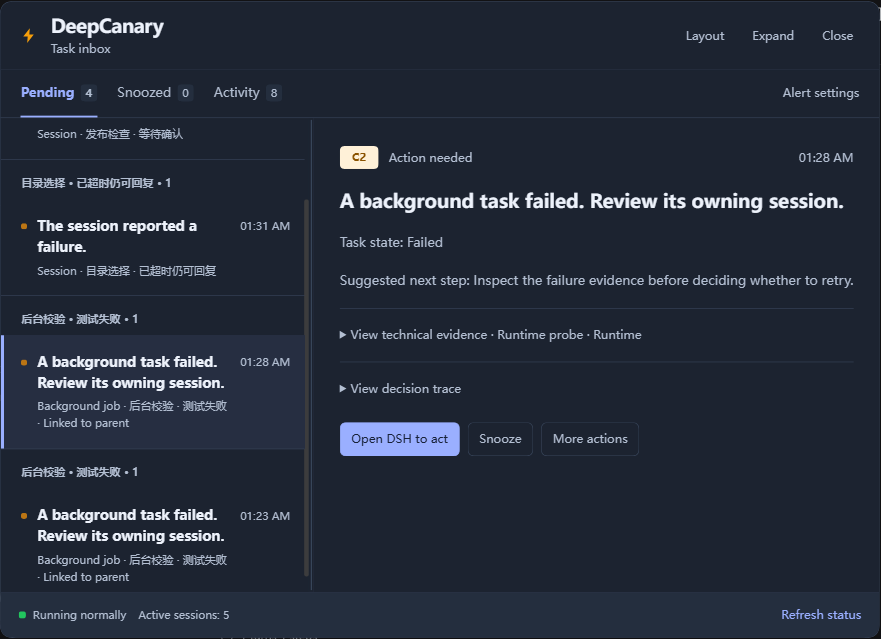

# DeepCanary

Task reminders for [DeepSeek Harness](https://github.com/deepseek-ai/deepseek-harness). See which tasks need your attention, postpone a reminder, and return to the right session.

[简体中文](README.zh-CN.md) · [Compatibility](docs/compatibility.md) · [Changelog](CHANGELOG.md)



## Requirements

DeepCanary 0.1.8 supports **DSH 0.2.1-rc.5 and 0.2.2-alpha.3**, on WebUI and Windows Desktop. Both versions use the same plugin and interface. The declared range also accepts later DSH releases. Versions actually exercised are listed in [Compatibility](docs/compatibility.md).

For WebUI, use the Node.js version required by your DSH release. DeepCanary accepts Node 22.19 or later in the 22.x line, or Node 24 and later. alpha.3 requires Node 24.9 or later. Desktop uses its bundled runtime.

## Install

The candidate version is **0.1.8-rc.3**. Use the supplied `.tgz` file and its SHA-256 checksum. Published downloads are listed in [GitHub Releases](https://github.com/Oscar-Williams/dsh-deepcanary/releases).

### WebUI

Stop the WebUI server, then install the file into the profile you use to start DSH. These commands use the standard `web` profile and a candidate file in the current directory.

```sh
dsh plugin --profile web add ./dsh-deepcanary-0.1.8-rc.3.tgz --registry=https://registry.npmjs.org/
dsh web
```

For a custom profile, replace `web` in both commands with its name. Keep the same `DSH_HOME` as your existing installation.

If you need to install DSH first, follow its [installation guide](https://github.com/deepseek-ai/deepseek-harness#readme). Select a supported release explicitly when using a prerelease channel.

### Windows Desktop

1. Exit DSH through **Application → Quit**.
2. Open PowerShell in `resources/runtime/cli/bin` inside the DSH application directory.
3. Replace the path below with the full path to your candidate file and run the command.

```powershell
.\dsh.cmd plugin --profile desktop add "<full-path-to-dsh-deepcanary-0.1.8-rc.3.tgz>" --registry=https://registry.npmjs.org/
```

Reopen DSH and check that DeepCanary appears in **Plugins**. Use the CLI bundled with that Desktop application so it manages the correct profile.

Once this candidate is published to npm, you can also enter `dsh-deepcanary@0.1.8-rc.3` in **Plugins → Add plugin**. Available npm versions are listed on the [package page](https://www.npmjs.com/package/dsh-deepcanary).

### Update or remove

Install the new candidate file with the same command and profile. If the manager requires removal before replacement, remove only the plugin and then add the new file. Keep your existing home and profile to retain reminders and settings.

To remove a WebUI installation, stop its server and run `dsh plugin --profile web remove dsh-deepcanary`. For Desktop, use **Plugins**, or run the equivalent command with `.\dsh.cmd` after exiting the application.

## Use the inbox

Open **DeepCanary** from the sidebar.

| View | Contents |
| --- | --- |
| Pending | Active questions, approvals, and task updates that need attention |
| Snoozed | Reminders you have scheduled for later |
| Activity | Routine completions, context compaction, and tasks you explicitly stopped |

Select a reminder to read its details. **Open in DSH** opens its session. Answer questions and handle approvals through DSH's native controls. **Acknowledge** clears the reminder, while **Snooze** schedules it for later.

At wide widths, the list and detail appear side by side. At narrow widths, switch between them without losing your selection or draft.

Drag the title bar to move the panel. Resize any edge or corner, drag the list divider, or use **Layout** to dock, restore, or reset it. The default size is 880×640. The panel fits smaller viewports and saves its layout on the current device.

For keyboard movement or resizing, choose the action from **Layout**. Use arrow keys to adjust, Shift for larger steps, Enter to confirm, and Escape to cancel.

## Enable notifications

Open the inbox and select **Reminder settings**. Allow notifications for the DSH site in your browser, and allow Edge or DeepSeek Harness notifications in Windows.

Keep a DSH page or the Desktop application running. Background pages and hidden Desktop windows can receive reminders. Quitting DSH stops the plugin. Windows Do Not Disturb and browser permissions can suppress the system banner.

C3 means a task currently needs an answer or approval. C2 suggests checking an abnormal state. Routine C1 updates appear in Activity. Quiet hours and reminder frequency can be adjusted in settings.

## Data and privacy

Reminders and settings stay in the selected DSH profile. Pages connected to the same running host share their inbox. Web and Desktop profiles keep separate reminder state.

DeepCanary stores task identifiers, reminder status, schedules, and notification records. It does not store conversation text, prompts, answers, tool arguments, or raw failure text. Reminder decisions use local rules. See [Security and privacy](docs/security.md) for details.

## Troubleshooting

| Problem | Action |
| --- | --- |
| DeepCanary is missing | Check **Plugins** in the application you use. Confirm the installation used its profile, then restart DSH. |
| Installation is rejected | Check the DSH version against [Compatibility](docs/compatibility.md). |
| No system banner appears | Check browser and Windows permissions, Do Not Disturb, reminder settings, and whether DSH is still running. |
| A session cannot be opened | It may have been removed or may no longer be available to this host. Open the inbox to inspect the reminder. |
| The panel is awkwardly sized | Choose **Layout → Reset layout**. |
| A save fails | Use the retry control in the inbox status area. Keep the existing state files when reporting the error. |

Report reproducible problems through [GitHub Issues](https://github.com/Oscar-Williams/dsh-deepcanary/issues). Include your DSH and DeepCanary versions, platform, and steps to reproduce. Remove credentials and private conversation content.

[Documentation](docs/README.md) · [Contributing](CONTRIBUTING.md) · [Screenshot details](docs/ui-captures.md) · [MIT license](LICENSE)
