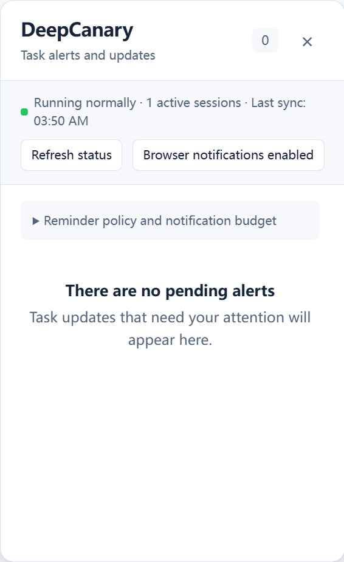

# DeepCanary

**Let tasks run quietly. Know when they need you. Return to the right session.**

[](https://www.npmjs.com/package/dsh-deepcanary)
[](https://github.com/Oscar-Williams/dsh-deepcanary/actions/workflows/ci.yml)
[](LICENSE)

English · [简体中文](README.zh-CN.md) · [Documentation](docs/README.md) · [Changelog](CHANGELOG.md)

DeepCanary adds a local task inbox to [DeepSeek Harness](https://github.com/deepseek-ai/deepseek-harness). It brings questions, approvals, failures and completion summaries together, applies quiet notification policies, and returns you to the relevant session.

**Release candidate: 0.1.6-rc.2.** The supported Host baseline is released DSH **0.2.1-rc.2** for WebUI and official Windows Desktop. Get the package from [npm](https://www.npmjs.com/package/dsh-deepcanary) or [GitHub Releases](https://github.com/Oscar-Williams/dsh-deepcanary/releases/tag/v0.1.6-rc.2). Both `latest` and `next` select this RC.

This version follows owned background jobs through completion and plugin reload, brings urgent pending work to the top of Inbox, and turns explicit handled feedback into a completed reminder action. Background failures return you to their owning session. Healthy background activity stays quiet.

Scheduled follow-up keeps work within reach: choose a delay, review it in **Scheduled**, adjust its time or restore it to pending. Due reminders use current notification preferences. Delivery generations protect each new arrangement across tabs and reloads, and retention gives human waits and scheduled work priority during routine update bursts.



## Install

### Desktop

Download `dsh-deepcanary-0.1.6-rc.2.tgz` and `SHA256SUMS` from the [release assets](https://github.com/Oscar-Williams/dsh-deepcanary/releases/tag/v0.1.6-rc.2). Open DSH **Plugins → Add plugin**, select the local tgz through the official package manager, and follow the manager's activation instructions. Save active work before a requested restart. Desktop owns its profile and manages its packages through the application.

### WebUI

Use DSH 0.2.1-rc.2 and an explicit Web profile:

```sh
dsh --version
dsh plugin --profile web add dsh-deepcanary@0.1.6-rc.2 --registry=https://registry.npmjs.org/
dsh web
```

To run the host through npm, prefix each command with `npx --yes --package=@deepseek-ai/dsh@0.2.1-rc.2`. For example:

```sh
npx --yes --package=@deepseek-ai/dsh@0.2.1-rc.2 dsh web
```

Open the authenticated URL printed by DSH. A built source checkout can use its documented `pnpm dsh` entry. Use that checkout's own package manager version.

To install the verified GitHub archive instead, use its local path:

```sh
dsh plugin --profile web add ./dsh-deepcanary-0.1.6-rc.2.tgz --registry=https://registry.npmjs.org/
```

### Update and remove

Use the official manager's update control when it offers one. An installation request for an already installed bundle can be refused by the current manager; remove that bundle through the manager before adding its replacement. Follow its applied/restart status and confirm the loaded version.

The Web CLI forwards package operations to pnpm. To update Web, run the version-pinned installation command above, finish current work, stop that Web Host, start `dsh web` again and reload its page. Confirm the loaded plugin version. To remove the Web installation:

```sh
dsh plugin --profile web remove dsh-deepcanary
```

DSH profiles own their sessions and configuration. Save active work before changing the owning host process.

## Use

1. Open **DeepCanary** from the DSH sidebar.
2. In DSH Settings, select **Built-in plugins → DeepCanary** to set the notification level, hourly budget and quiet hours.
3. Enable browser notifications when you want them, then run your tasks normally.
4. Use an Inbox item's session action to return, inspect its evidence, snooze it or provide explicit feedback.

| Level | Meaning | Behavior |
| --- | --- | --- |
| C1 | Suggested check | Routine outcomes and completion summaries remain in Inbox. |
| C2 | Needs attention | Failures and possible stalls follow your notification policy. |
| C3 | Immediate human attention | Requires authoritative evidence of an active question, approval or blocking condition. |

Related events are grouped and deduplicated. Healthy long tools retain bounded progress grace. Timed questions remain answerable after timeout, and accepted replies close their reminder. Completion summaries survive recovery and reload. Stopped tasks retain their stopped state; fork history stays quiet.

Owned background jobs appear in the activity status while they run. Increasing output byte counts supply progress facts and close a previous stall reminder when activity returns. During live observation, uncollected completion enters Inbox at C1 and producer failure enters at C2; outcomes received by a waiter and intentional cancellation remain quiet. A completed reply with continuing background work says so explicitly. Reload restores watched jobs and collects missed observations once. Catch-up messages identify their recovery context; prior collection remains unknown. Tasks the Host cannot confirm retain unknown status.

Inbox orders pending items by urgency, with questions and approvals ahead of routine updates. Further pages remain accessible through **Show more updates**. Choosing **Already resolved** records your feedback and marks that reminder handled; new questions retain their own reminder lifecycle.

**Remind later** offers 5, 15, 30 and 60 minutes. Scheduled cards show their return time and remain inspectable. At the deadline, C1 returns to Inbox; C2 follows quiet hours and the rolling budget; authoritative C3 retains its boundary. A resolved or acknowledged item stays closed. The ordinary profile state preserves deduplication, budget and delivery claims through replacement. Claims are saved before notification construction is authorized. OS visibility still requires an actual observation.

The resizable Inbox has opaque light/dark surfaces, keyboard controls and expandable evidence. Navigation verifies the target in DSH's public session catalog. An unavailable target keeps its summary and explains its availability.

Settings use the Host's revision-aware configuration service. A concurrent write produces a conflict and preserves the draft. Discarding the draft reads the current Host snapshot. Plugin replacement waits for pending reminder writes before the replacement starts reading state.

## Privacy

Reminder state stays in the local profile. Stored fields are bounded metadata, hashed references, explicit feedback and the local session handle needed for navigation. Conversation text, prompts, model output, tool arguments and credentials remain in their owning Host services.

HTTP endpoints use DSH's authenticated shared API, Host/Origin checks, bounded JSON input and sanitized errors. Feedback is optional. Usefulness comes from explicit feedback. See [security](docs/security.md) and [feedback calibration](docs/feedback-calibration.md).

## Compatibility and limits

- Notifications require a running Host and renderer, browser permission and suitable OS settings. Device observations establish actual delivery and click behavior.
- Desktop shares the core, settings and Inbox. Public third-party window wake and background notification capabilities remain unavailable in the current official Desktop baseline.
- Windows WebUI and Desktop are the device targets. CI configuration also covers source checks on its named operating systems.
- Supervisor is experimental and disabled by default. Its local projection lasts while the owning Host runs.
- Natural feedback guides defect investigation. Policy calibration and selective Judge retain their evidence requirements; live decisions use deterministic rules.

See [compatibility](docs/compatibility.md), [roadmap](docs/roadmap.md), [development](docs/development.md), [architecture](docs/architecture.md) and [contributing](CONTRIBUTING.md).

## License

[MIT](LICENSE). Built on the public DeepSeek Harness plugin APIs.
