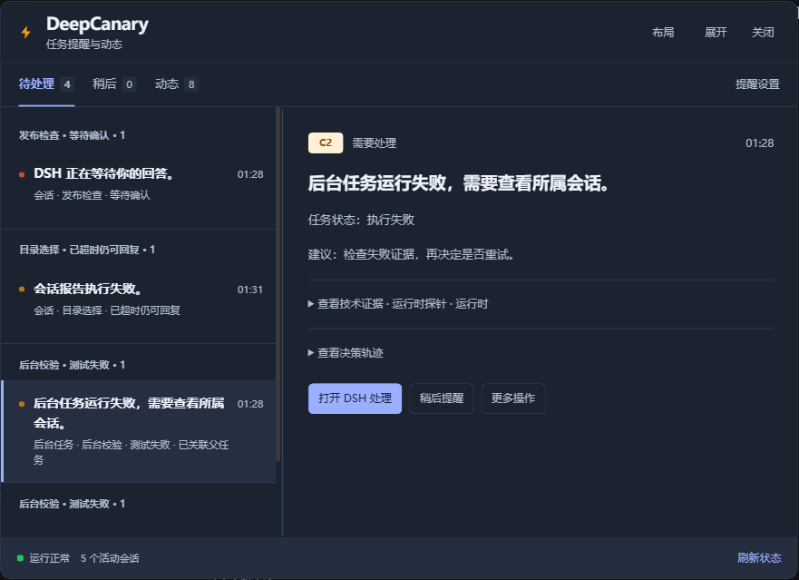

# DeepCanary

[DeepSeek Harness](https://github.com/deepseek-ai/deepseek-harness) 的任务提醒插件。查看需要处理的任务，安排稍后提醒，并返回对应会话。

[English](README.md) · [兼容性](docs/compatibility.md) · [更新记录](CHANGELOG.md)



## 使用要求

DeepCanary 0.1.8 支持 **DSH 0.2.1-rc.5 和 0.2.2-alpha.3**，适用于 WebUI 和 Windows 桌面版，两版使用相同的插件和界面。版本声明也接受后续 DSH 更新，实际验证范围见[兼容性说明](docs/compatibility.md)。

WebUI 使用所选 DSH 版本要求的 Node.js。DeepCanary 支持 Node 22.19 及以上的 22.x 版本，或 Node 24 及以上版本；alpha.3 要求 Node 24.9 及以上版本。桌面版使用应用自带的运行时。

## 安装

当前候选版本为 **0.1.8-rc.3**。使用随附的 `.tgz` 文件，并核对其 SHA-256 校验值。已发布的下载文件见 [GitHub Releases](https://github.com/Oscar-Williams/dsh-deepcanary/releases)。

### WebUI

先停止 WebUI 服务，再把候选包安装到平时启动 DSH 所用的 profile。以下命令使用标准 `web` profile，候选文件位于当前目录。

```sh
dsh plugin --profile web add ./dsh-deepcanary-0.1.8-rc.3.tgz --registry=https://registry.npmjs.org/
dsh web
```

使用自定义 profile 时，将两条命令中的 `web` 换成它的名称，并沿用原来的 `DSH_HOME`。

尚未安装 DSH 时，先按其[安装说明](https://github.com/deepseek-ai/deepseek-harness#readme)安装。使用预发布渠道时，明确选择本插件支持的宿主版本。

### Windows 桌面版

1. 从 DSH 的**应用 → 退出**正常关闭应用。
2. 在 DSH 安装目录下的 `resources/runtime/cli/bin` 中打开 PowerShell。
3. 将下方路径替换为候选文件的实际完整路径，然后执行命令。

```powershell
.\dsh.cmd plugin --profile desktop add "<dsh-deepcanary-0.1.8-rc.3.tgz 的完整路径>" --registry=https://registry.npmjs.org/
```

重新打开 DSH，在**插件**页面确认 DeepCanary 已出现。使用该桌面应用自带的 CLI，确保操作的是它所管理的 profile。

本候选版发布到 npm 后，也可在**插件 → 添加插件**中填写 `dsh-deepcanary@0.1.8-rc.3`。npm 当前可用版本见[包页面](https://www.npmjs.com/package/dsh-deepcanary)。

### 更新或卸载

使用同一命令和 profile 安装新的候选文件。若管理器要求先移除再替换，仅移除插件后重新添加，保留原 home 和 profile，以便继续使用已有提醒和设置。

卸载 WebUI 中的插件时，先停止服务，再执行 `dsh plugin --profile web remove dsh-deepcanary`。桌面版可在**插件**页面卸载，也可退出应用后用 `.\dsh.cmd` 执行对应命令。

## 使用收件箱

点击侧边栏的 **DeepCanary**。

| 分类 | 显示内容 |
| --- | --- |
| 待处理 | 正在等待回答或审批的事项，以及需要关注的任务变化 |
| 稍后 | 已安排在指定时间再次提醒的事项 |
| 动态 | 普通完成、上下文压缩，以及你主动停止的任务 |

选择一条提醒查看详情。点击**跳转到 DSH**进入对应会话，在 DSH 原生界面中回答问题或处理审批。**已处理**关闭这条提醒，**稍后提醒**为它安排下一次提醒时间。

宽屏下，列表和详情并排显示；窄屏下可在两者之间切换，保留选择和草稿。

拖动标题栏可以移动面板，拖动任一边缘或角落可以调整大小，分栏也可拖动调整。**布局**菜单提供停靠、恢复和重置。默认尺寸为 880×640，面板会适应较小的可视区域，并在当前设备保存布局。

从**布局**菜单进入键盘移动或调整大小后，用方向键调整，按住 Shift 加大步长，Enter 确认，Esc 取消。

## 启用通知

打开收件箱，点击**提醒设置**。在浏览器中允许 DSH 站点发送通知，并在 Windows 中允许 Edge 或 DeepSeek Harness 显示通知。

保留 DSH 网页或桌面应用运行，后台网页和隐藏的桌面窗口也可收到提醒。完全退出 DSH 后，插件随之停止。Windows“勿扰”和浏览器权限会影响系统横幅显示。

C3 表示任务正在等待回答或审批，C2 提示检查异常状态，普通 C1 更新进入动态。静默时段和提醒频率可在设置中调整。

## 数据与隐私

提醒和设置保存在所选 DSH profile 中。连接同一运行中宿主的页面共享收件箱，Web 与 Desktop profile 分别保存提醒状态。

DeepCanary 保存任务标识、提醒状态、稍后安排和通知记录，不保存会话正文、提示词、答案、工具参数或原始失败文本。提醒判定使用本地规则，详见[安全与隐私说明](docs/security.md)。

## 常见问题

| 问题 | 处理方法 |
| --- | --- |
| 找不到 DeepCanary | 在当前应用的**插件**页面确认已安装，核对安装时使用的 profile，然后重启 DSH。 |
| 安装被拒绝 | 对照[兼容性说明](docs/compatibility.md)检查 DSH 版本。 |
| 没有系统横幅 | 检查浏览器与 Windows 通知权限、“勿扰”、提醒设置，以及 DSH 是否仍在运行。 |
| 无法返回会话 | 会话可能已删除，或已不在当前宿主可访问的范围中。可先回到收件箱查看提醒。 |
| 面板尺寸不合适 | 选择**布局 → 重置布局**。 |
| 保存失败 | 使用收件箱状态区域的重试按钮，报告问题时保留已有状态文件。 |

可通过 [GitHub Issues](https://github.com/Oscar-Williams/dsh-deepcanary/issues)报告可复现的问题，附上 DSH 与 DeepCanary 版本、平台和操作步骤，并移除凭据及私密会话内容。

[文档目录](docs/README.md) · [参与开发](CONTRIBUTING.md) · [截图说明](docs/ui-captures.md) · [MIT 许可证](LICENSE)
