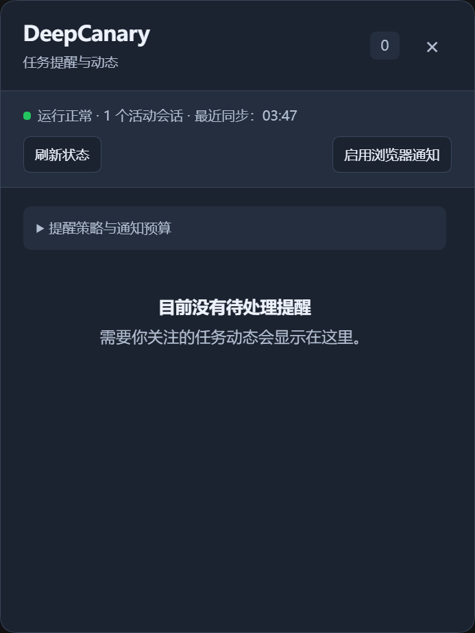

# DeepCanary

**任务安心运行，需要处理时及时提醒，回来后直接找到正确会话。**

[English](README.md) · 简体中文 · [文档](docs/README.md) · [更新记录](CHANGELOG.md)

DeepCanary 为 [DeepSeek Harness](https://github.com/deepseek-ai/deepseek-harness) 提供本地任务收件箱，将提问、审批、异常和完成摘要集中呈现，并通过通知预算、合并与去重减少打扰。

**当前开发候选为 0.1.5-rc.1，以本地 tgz 提供。** Web 开发基线为 DSH 0.2.1-rc.1；Windows Desktop 使用当前官方可用的 0.2.0-rc.2。npm 已发布版本仍为 0.1.4-rc.1，其宿主基线为 DSH 0.2.0-rc.2。



## 安装本地候选

准备构建好的 `dsh-deepcanary-0.1.5-rc.1.tgz`，保留随包提供的校验值。

### Desktop

在 DSH 的“插件 → 添加插件”中通过官方管理器选择本地 tgz，按界面提示启用。需要重启时先保存进行中的工作。桌面版通过应用管理自己的 profile 与插件。

### WebUI

使用 DSH 0.2.1-rc.1，在明确的 Web profile 中安装：

```sh
dsh --version
dsh plugin --profile web add ./dsh-deepcanary-0.1.5-rc.1.tgz --registry=https://registry.npmjs.org/
dsh web
```

通过 npm 运行宿主时，可以在每条命令前加 `npx --yes --package=@deepseek-ai/dsh@0.2.1-rc.1`。例如：

```sh
npx --yes --package=@deepseek-ai/dsh@0.2.1-rc.1 dsh web
```

打开 DSH 输出的认证地址。已构建的源码检出可使用其文档规定的 `pnpm dsh` 入口，并遵循该检出的包管理器版本。

### 更新与卸载

优先使用官方管理器提供的更新操作。当前管理器可能拒绝重复安装已存在的组合包；此时先在管理器中移除该包，再安装替换包。按实际生效或重启提示处理，并确认加载版本。

Web CLI 将包操作转交 pnpm。更换本地压缩包时重新执行对应安装命令，并按 DSH 的生效提示处理。卸载 Web profile 中的插件：

```sh
dsh plugin --profile web remove dsh-deepcanary
```

会话和配置由 DSH profile 管理。改变宿主进程前先保存当前工作。

## 使用

1. 从 DSH 侧栏打开 **DeepCanary**。
2. 在 DSH 设置中选择 DeepCanary：Web 0.2.1 的入口为“内置插件”，Desktop 0.2.0 为“插件”。在这里调整提醒级别、每小时打断预算和静默时段。
3. 按需启用浏览器通知，然后正常运行任务。
4. 从收件箱返回对应会话、查看依据、稍后处理或提供明确反馈。

| 级别 | 含义 | 行为 |
| --- | --- | --- |
| C1 | 建议查看 | 正常结果和完成摘要保留在收件箱 |
| C2 | 需要关注 | 异常和可能的停滞按策略提醒 |
| C3 | 需要及时处理 | 活跃提问、审批或阻塞须有宿主权威事实 |

相关事件会合并并去重。健康长工具享有有界进展宽限；异步问题超时后仍可回答，宿主正式接纳答案后闭合。完成摘要在恢复和重载后保留。停止任务保留其状态，分叉历史保持安静。

面板使用不透明的深浅色表面，支持缩放、键盘及展开依据。返回操作通过 DSH 的公开会话目录确认目标。目标失效时保留摘要并说明当前可用性。

设置通过宿主配置服务持久化。并发修改产生冲突时保留草稿，放弃草稿后读取当前宿主值。插件替换会等待提醒状态写入结束，随后再读取新实例状态。

## 隐私

提醒状态保存在本地 profile，仅包含有界元数据、哈希引用、明确反馈和必要的本地会话导航句柄。会话原文、提示词、模型输出、工具参数和凭据由原有宿主服务管理。

HTTP 接口继承宿主认证及 Host/Origin 检查，限制 JSON 大小并使用脱敏错误。反馈按需提供，提醒是否有用由明确反馈表达。详见[安全说明](docs/security.md)和[反馈校准](docs/feedback-calibration.md)。

## 兼容性与限制

- 通知依赖持续运行的宿主和渲染页面、浏览器权限及操作系统设置；实际送达和点击结果需要设备观察。
- 桌面端共用核心、设置和收件箱。当前官方桌面基线尚未提供第三方插件可调用的窗口唤回与后台通知能力。
- 本轮设备目标为 Windows WebUI 与 Desktop；CI 配置同时覆盖其列出的系统源码检查。
- Supervisor 为实验能力，默认关闭，其本地投影随所属宿主进程运行。
- 自然反馈用于具体缺陷调查；策略校准和选择性 Judge 按证据条件推进，实时判断采用确定性规则。

更多信息见[兼容说明](docs/compatibility.md)、[开发](docs/development.md)、[架构](docs/architecture.md)和[参与贡献](CONTRIBUTING.md)。

## 许可证

[MIT](LICENSE)。通过 DeepSeek Harness 的公开插件接口构建。
